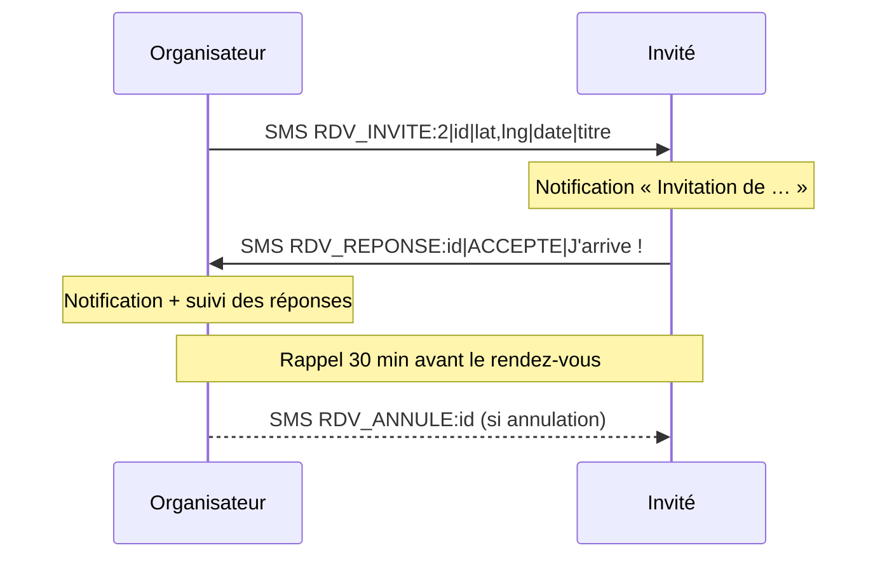

# GeoRDV : rendez-vous géolocalisés par SMS

Application Android qui permet d'**inviter ses contacts à un rendez-vous géolocalisé par simple SMS**, sans connexion Internet ni compte utilisateur. Les invités reçoivent une notification, voient le lieu sur une carte, la distance et le temps de trajet, et répondent en un clic.

Projet réalisé à l'ENSEIRB-MATMECA, en Java natif Android, **sans aucune bibliothèque externe**.

## Fonctionnalités

### Organiser un rendez-vous
- Titre, **date et heure** (sélecteurs natifs)
- Un ou plusieurs invités : saisie du numéro ou choix dans le **répertoire**
- Lieu : **position GPS actuelle** ou coordonnées saisies, avec aperçu sur la carte
- Envoi de l'invitation par SMS à tous les invités

### Recevoir une invitation
- **Notification** dès la réception du SMS, avec le **nom du contact**
- Détail du rendez-vous : titre, date, **distance et temps de marche** depuis sa position
- **Carte** avec le lieu nommé et **itinéraire** à pied en un clic
- Réponse **Accepter / Refuser** avec un **message** facultatif (« J'arrive dans 10 min »)

### Suivre ses rendez-vous
- **Historique** de tous les rendez-vous envoyés et reçus
- **Suivi des réponses** pour chaque invitation envoyée : qui a accepté, refusé ou n'a pas encore répondu, avec leurs messages
- **Rappel** par notification 30 minutes avant le rendez-vous
- **Annulation** d'un rendez-vous : les invités sont prévenus automatiquement par SMS
- **Partage** du rendez-vous par n'importe quelle application (WhatsApp, e-mail…) avec un lien Google Maps

## Comment ça marche



### Protocole SMS

| Message | Format |
|---|---|
| Invitation | `RDV_INVITE:2\|id\|latitude,longitude\|dateHeure\|titre` |
| Réponse | `RDV_REPONSE:id\|ACCEPTE ou REFUSE\|message` |
| Annulation | `RDV_ANNULE:id` |

- L'**identifiant** relie chaque réponse au bon rendez-vous, même si l'organisateur en a plusieurs en cours.
- Le **format de la version 1** (`RDV_INVITE:lat,lng` et `RDV_REPONSE:ACCEPTE`) est toujours compris, pour rester compatible avec les anciennes installations.
- Les messages longs sont découpés et recomposés automatiquement.
- Un même numéro peut arriver sous plusieurs formes (`06…` ou `+33 6…`) : les numéros sont comparés sur leurs 9 derniers chiffres.

## Architecture

```
fr.enseirb.geordv
├── MainActivity              création d'un rendez-vous
├── InvitationRecueActivity   invitation reçue : détails, distance, réponse
├── HistoriqueActivity        liste des rendez-vous envoyés et reçus
├── DetailRdvActivity         suivi des réponses, annulation, partage
├── SmsReceiver               réception des SMS GeoRDV
├── RappelReceiver            rappel 30 minutes avant
├── model/                    Java pur, testé sans téléphone
│   ├── RendezVous
│   ├── MessageRdv            protocole SMS (écriture et lecture)
│   ├── Numeros               nettoyage et comparaison des numéros
│   └── Trajet                distance (haversine) et temps de marche
├── data/
│   └── RdvDatabase           stockage SQLite (rendez-vous et réponses)
└── util/                     notifications, SMS, contacts, cartes, rappels
```

**Choix techniques**
- **Aucune bibliothèque externe** : SQLite, notifications, alarmes et sélecteurs de date sont ceux d'Android.
- **Notifications plutôt qu'ouverture directe d'un écran** : depuis Android 10, une application ne peut plus afficher un écran depuis l'arrière-plan.
- Le **récepteur de SMS est protégé** (`BROADCAST_SMS`) : seul le système peut lui transmettre des messages.
- La logique métier (`model/`) n'utilise pas Android : elle est couverte par des **tests unitaires JUnit**.

## Tests

```bash
./gradlew test
```

Les tests couvrent le protocole SMS (écriture, lecture, compatibilité avec la version 1, messages invalides), la comparaison des numéros et le calcul des distances.

## Installation

1. Ouvrir le projet dans **Android Studio**.
2. Lancer l'application sur **deux téléphones** (ou deux émulateurs) pour échanger des SMS.
3. Accepter les permissions : SMS, position, contacts et notifications.

Configuration : Android 5.0 minimum (API 21), cible Android 15 (API 35).

## Historique des versions

| Version | Ajouts |
|---|---|
| 1 | Invitation GPS par SMS, plusieurs destinataires, choix d'un contact, acceptation ou refus |
| 2 | Affichage du lieu sur une carte |
| 3 | Lieu du rendez-vous saisi manuellement |
| 4 | Titre, date et heure, notifications, historique, suivi des réponses, message de réponse, distance et itinéraire, rappels, annulation, partage, tests unitaires |

## Auteur

Amine CHIBOUB · [LinkedIn](https://www.linkedin.com/in/mohamed-amine-chiboub/) · [GitHub](https://github.com/AmineCHIBOUB)
